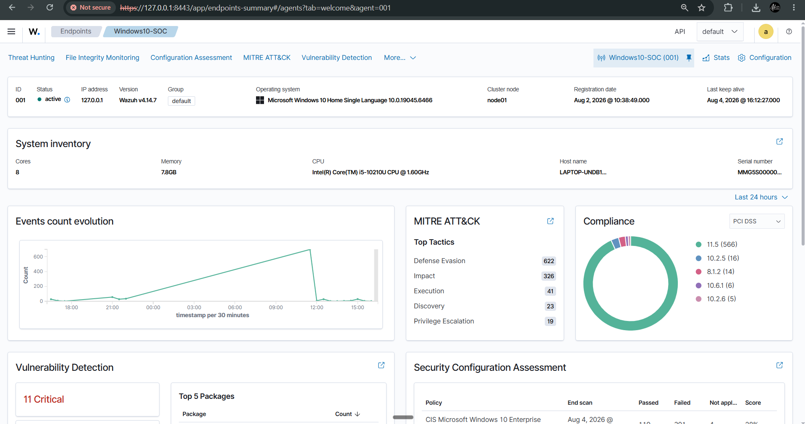
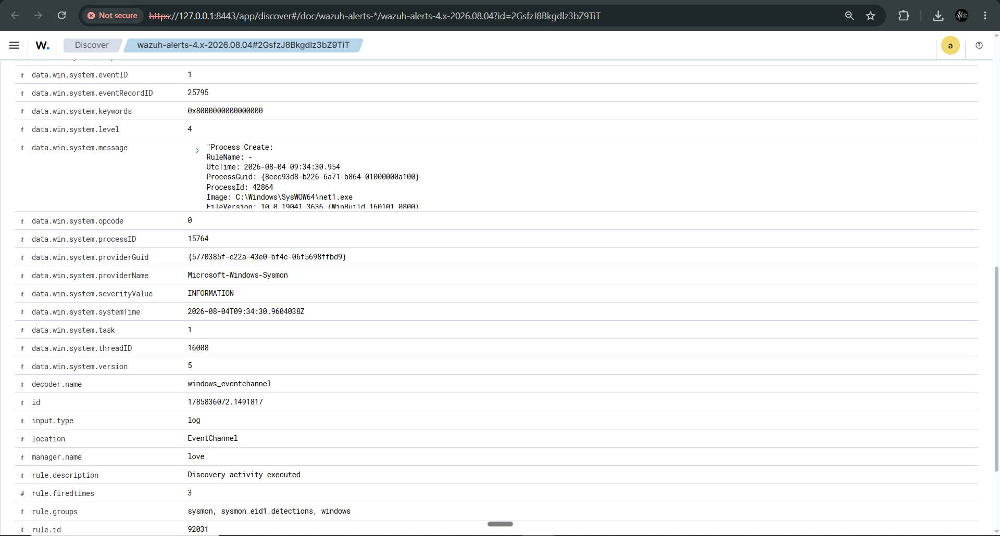
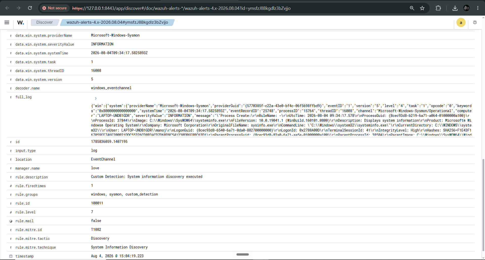
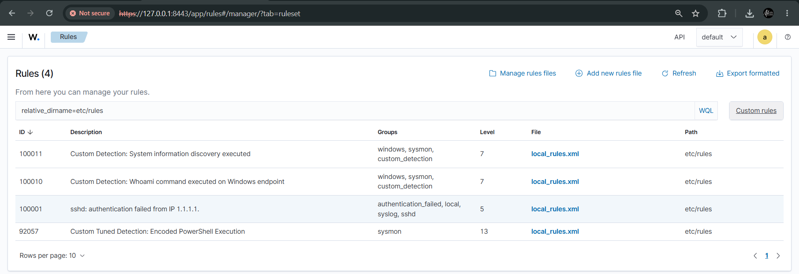
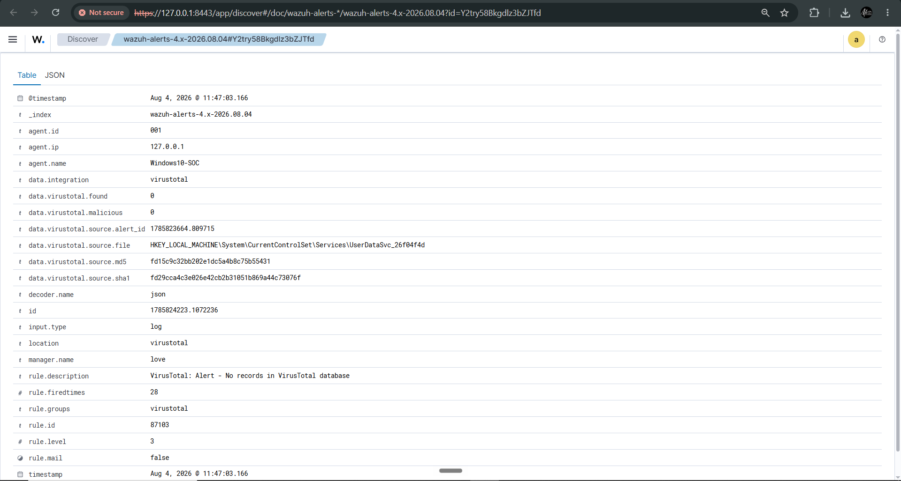
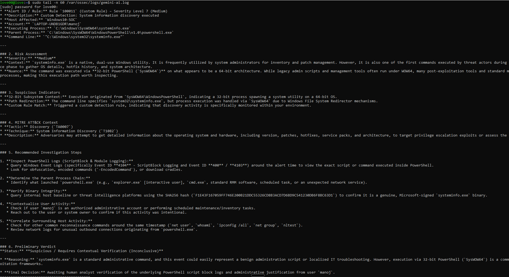
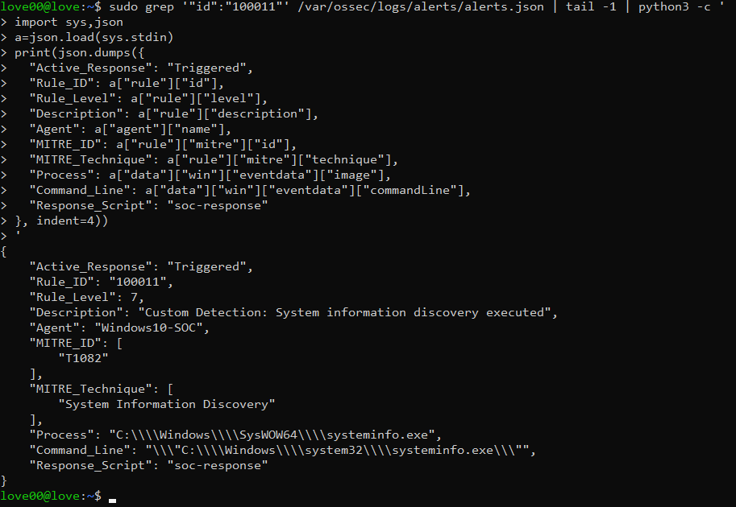
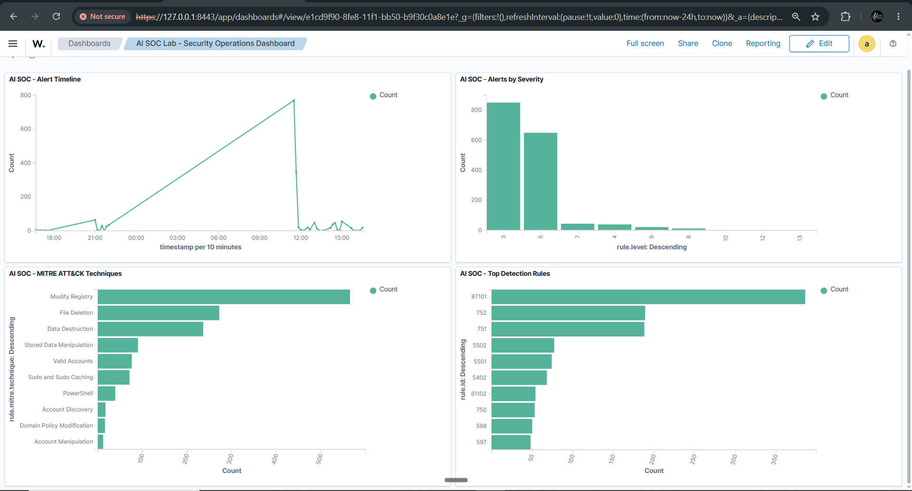

# AI-Assisted SOC Lab with Wazuh

A hands-on Security Operations Center lab progressing from Windows endpoint telemetry and SIEM monitoring into custom detection engineering, threat-intelligence enrichment, AI-assisted investigation, controlled incident response, and SOC visualization.

> **Security:** No live Gemini, VirusTotal, Wazuh, or other credentials belong in this repository. All examples use placeholders.

## Architecture

```text
Windows 10 Endpoint
        |
      Sysmon
        |
        v
      Wazuh SIEM
        |
        +--> Custom Detections + MITRE ATT&CK
        +--> FIM --> VirusTotal enrichment
        +--> Gemini AI-assisted investigation
        +--> Controlled Active Response
        |
        v
  SOC Security Dashboard
```

The AI layer is an analyst assistant, not an autonomous decision-maker. Wazuh performs deterministic detection/response; Gemini summarizes context, highlights indicators, recommends investigation steps, and returns a preliminary verdict for analyst review.

## Lab stack

| Component | Role |
|---|---|
| Ubuntu Server VM | Wazuh all-in-one server |
| Windows 10 | Monitored endpoint |
| Sysmon | Detailed Windows telemetry |
| Wazuh | SIEM/XDR, FIM, integrations and Active Response |
| MITRE ATT&CK | Detection mapping |
| VirusTotal | IOC/file reputation enrichment |
| Google Gemini | AI-assisted alert investigation |
| VMware | Virtualized lab environment |

The host had limited RAM, so the architecture was deliberately kept compact.

## Build progression

### 1. Wazuh infrastructure
The lab began with Ubuntu Server and Windows 10. Early Wazuh indexer installation attempts exposed VM resource constraints. After stabilizing resources and Wazuh services, the dashboard became the central SOC interface.

### 2. Endpoint + Sysmon
The Windows endpoint was enrolled as a Wazuh agent. Sysmon supplied process-creation and command-line telemetry, which Wazuh ingested for threat hunting and rule evaluation.

### 3. Detection validation
Safe lab activity was generated to validate the telemetry pipeline and built-in detections before custom logic was introduced.

### 4. Custom detection engineering
Environment-specific Wazuh rules were created and tested. A key custom detection identifies `systeminfo.exe` and maps it to MITRE ATT&CK **T1082 — System Information Discovery**.

An earlier encoded-PowerShell test continued matching Wazuh built-in rule `92057`. Rather than duplicating an effective built-in detection, the project moved to custom behavior that could be demonstrated cleanly.

Sanitized example:

```xml
<group name="windows,sysmon,custom_detection,">
  <rule id="100011" level="7">
    <if_group>sysmon_event1</if_group>
    <field name="win.eventdata.image" type="pcre2">(?i)\\systeminfo\.exe$</field>
    <description>Custom Detection: System information discovery executed</description>
    <mitre><id>T1082</id></mitre>
  </rule>
</group>
```

See `configs/local_rules.example.xml`.

### 5. Phishing investigation workflow
A phishing-analysis phase modeled a common SOC workflow: inspect sender/domain information, URLs, attachments/hashes and other IOCs; enrich suspicious artifacts; correlate relevant SIEM activity; and reach an analyst verdict.

### 6. Threat intelligence
Wazuh File Integrity Monitoring was connected to VirusTotal enrichment. File events could therefore be enriched with external reputation information. The live VirusTotal key is deliberately excluded.

### 7. AI-assisted investigation
Gemini was first tested manually against alert data, then automated for selected Wazuh alerts. The structured analysis included alert summary, risk assessment, suspicious indicators, MITRE context, recommended investigation steps, and a preliminary verdict.

### 8. Automated Wazuh-to-Gemini pipeline

```text
Windows activity
 -> Sysmon
 -> Wazuh custom rule 100011
 -> custom-gemini integration
 -> Gemini API
 -> structured AI investigation
 -> gemini-ai.log
```

A dedicated Python virtual environment under `/opt/wazuh-ai-venv` allowed the Wazuh service account to execute the integration without modifying Ubuntu's system Python.

### 9. Controlled incident response
Wazuh Active Response was demonstrated against the custom detection. The response was deliberately non-destructive: it recorded that the response workflow had triggered instead of automatically killing a legitimate dual-use process or blocking networking.

```text
                         +--> Gemini investigation
Wazuh Rule 100011 -------+
                         +--> Controlled Active Response
```

### 10. SOC dashboard
The final Wazuh dashboard contains four visualizations: **Alerts by Severity**, **MITRE ATT&CK Techniques**, **Top Detection Rules**, and **Alert Timeline**.

## Evidence

The following captures document the validated SOC pipeline from endpoint onboarding through detection, enrichment, AI-assisted investigation and response.

### 1. Windows endpoint connected to Wazuh


### 2. Sysmon Process Create telemetry


### 3. Custom detection — Rule 100011 / MITRE T1082


### 4. Custom detection rule configuration


### 5. VirusTotal threat-intelligence enrichment


### 6. Gemini AI-assisted investigation


### 7. Controlled Wazuh Active Response


### 8. Final SOC dashboard


## Key troubleshooting lessons

- **Wazuh/indexer resource pressure:** the original VM allocation was too constrained; resources/services were stabilized before continuing.
- **Custom PowerShell rule not appearing:** the behavior was already covered by built-in rule `92057`; the lab avoided unnecessary duplicate detection logic.
- **Custom rule deployment:** Wazuh's server-management interface reduced command-line friction and successfully exposed custom rules in the dashboard.
- **VirusTotal/FIM visibility:** configuration placement and reload behavior had to be corrected before enrichment appeared.
- **JSON handling:** raw Wazuh alert JSON required structured parsing rather than relying on visually messy terminal output.
- **PEP 668:** Ubuntu blocked installing `google-genai` into system Python, so an isolated venv was used instead of bypassing OS protections.
- **Service-account permissions:** a venv under `/home/...` was inaccessible to the `wazuh` user; moving it to `/opt/wazuh-ai-venv` with appropriate permissions solved automated execution.
- **Active Response formatting:** the response worked even though the first evidence log stored a large JSON object on one line; presentation was separated from execution validation.

## Secret management

- Never commit real Gemini or VirusTotal API keys.
- Never commit the live `/var/ossec/etc/ossec.conf`.
- Never commit `.env`, `gemini.conf`, shell profiles containing credentials, or raw backup directories.
- Documentation uses `YOUR_GEMINI_API_KEY` and `YOUR_VIRUSTOTAL_API_KEY` placeholders only.
- If a credential is ever committed accidentally, revoke/rotate it immediately; removing the visible line alone does not remove it from Git history.

## Repository layout

```text
AI-Assisted-SOC-Detection-Response-Lab/
├── README.md
├── .gitignore
├── configs/
│   ├── local_rules.example.xml
│   ├── ossec.conf.example
│   ├── custom-gemini.example
│   └── soc-response.example
├── docs/
│   ├── architecture.md
│   ├── detection-engineering.md
│   ├── ai-integration.md
│   ├── incident-response.md
│   └── troubleshooting.md
└── evidence/
    ├── 01-agent-active.png
    ├── 02-sysmon-telemetry.png
    ├── 03-custom-detection-100011.png
    ├── 04-custom-rules.png
    ├── 05-virustotal-enrichment.png
    ├── 06-gemini-ai-investigation.png
    ├── 07-active-response.png
    ├── 08-final-soc-dashboard.png
    └── README.md
```

## Skills demonstrated

Windows endpoint onboarding, Sysmon telemetry, SIEM threat hunting, Wazuh custom detection engineering, MITRE ATT&CK mapping, FIM, threat-intelligence enrichment, phishing investigation methodology, AI-assisted alert triage, external API integration, controlled incident response, SOC dashboarding, Linux/Python troubleshooting, and service-account permission management.

## Scope

This is a controlled home lab, not a production SOC. Gemini output can be incomplete or incorrect and requires analyst validation. VirusTotal reputation is enrichment, not proof of maliciousness. Destructive Active Response actions require careful tuning and testing before production use.

## Status

**Technical lab build: complete.**
